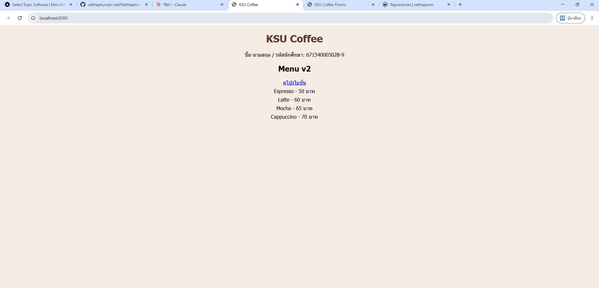
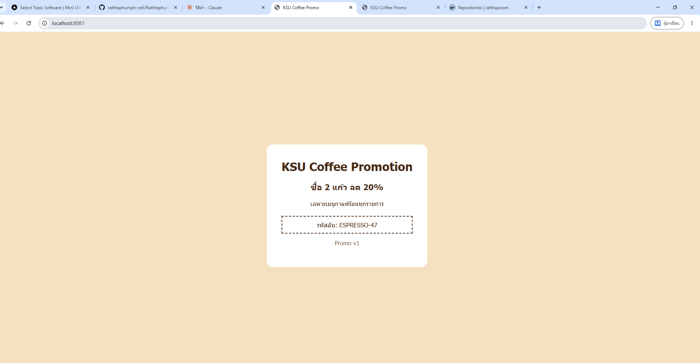

# ANSWER — <นาย รัฐภูมิ  ผุดผ่อง> 671540005028-9

## Part A — ข้อมูลจาก image kamthornsa/ksu-promo:1.0

| คำถาม | คำตอบ | คำสั่งที่ใช้ |
| --- | --- | --- |
| Port | <ค่าจากผลลัพธ์ เช่น 3000> | `docker image inspect kamthornsa/ksu-promo:1.0 --format '{{json .Config.ExposedPorts}}'` |
| CMD | <ค่าจากผลลัพธ์> | `docker image inspect kamthornsa/ksu-promo:1.0 --format '{{json .Config.Cmd}}'` |
| Base image | <ค่าจากผลลัพธ์> | `docker history kamthornsa/ksu-promo:1.0 --no-trunc` |

## Part B — รหัสลับบนหน้าโปรโมชั่น

<รหัสลับที่เห็นที่ http://localhost:8081 ตอนใช้ tag 1.0>

## Part C — คำถาม

1. ข้อความบนหน้าโปรโมชั่นถูกฝังอยู่ใน image ที่ build เสร็จแล้ว เรามีแค่ image ไม่มีซอร์สโค้ด และ image เป็นแบบอ่านอย่างเดียว แก้ไม่ได้ ส่วนหน้าเมนูเรามี index.html ของตัวเอง แก้แล้ว build ใหม่ได้

2. ผลที่ทดลอง: <เขียนสิ่งที่เห็นจริง เช่น หน้าเว็บ/รหัสลับต่างจาก 1.0 อย่างไร> เพราะถ้าไม่ใส่ tag Docker จะใช้ tag `latest` ซึ่งเป็นคนละเวอร์ชันกับ 1.0 จึงควรระบุ tag ให้ชัดเจนเสมอ

3. เลขซ้ายคือ port ของเครื่องโฮสต์ (8081) ที่เราใช้เปิดผ่านเบราว์เซอร์ เลขขวาคือ port ที่แอปฟังอยู่ภายใน container ซึ่งจากการตรวจ image คือ 3000 ไม่ใช่ 80 เพราะ 80 เป็นของ nginx แต่แอปนี้ไม่ได้ใช้ nginx

4. จะไม่เปลี่ยน เพราะ `up -d` ใช้ image ที่ build ไว้แล้วซ้ำ ไม่ build ใหม่ แม้ไฟล์ index.html จะเปลี่ยน คำสั่งที่ถูกต้องคือ `docker compose up -d --build` ซึ่ง build image ใหม่และสร้าง container menu ใหม่ โดย promo ไม่ถูกแตะต้อง

5. ใช้ `http://localhost:8081` เพราะลิงก์ถูกคลิกในเบราว์เซอร์บนเครื่องผู้ใช้ ซึ่งอยู่นอก Docker network จึงไม่รู้จักชื่อ `promo` ชื่อ service ใช้ได้เฉพาะระหว่าง container ด้วยกัน และ 3000 เป็น port ภายใน container ที่ไม่ได้เปิดออกมาที่โฮสต์ (โฮสต์เปิดเป็น 8081)

## ภาพหน้าจอ

